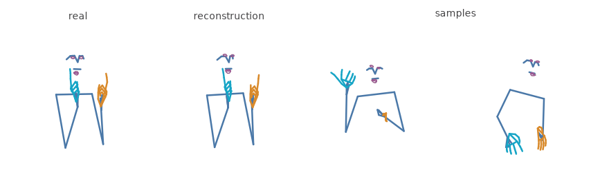
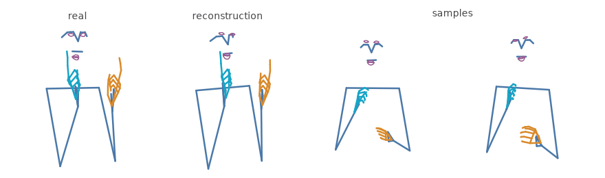
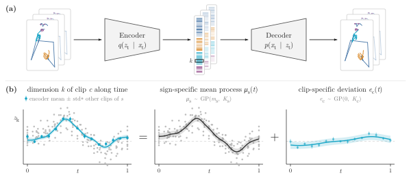
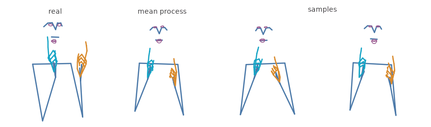
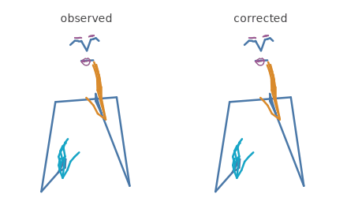
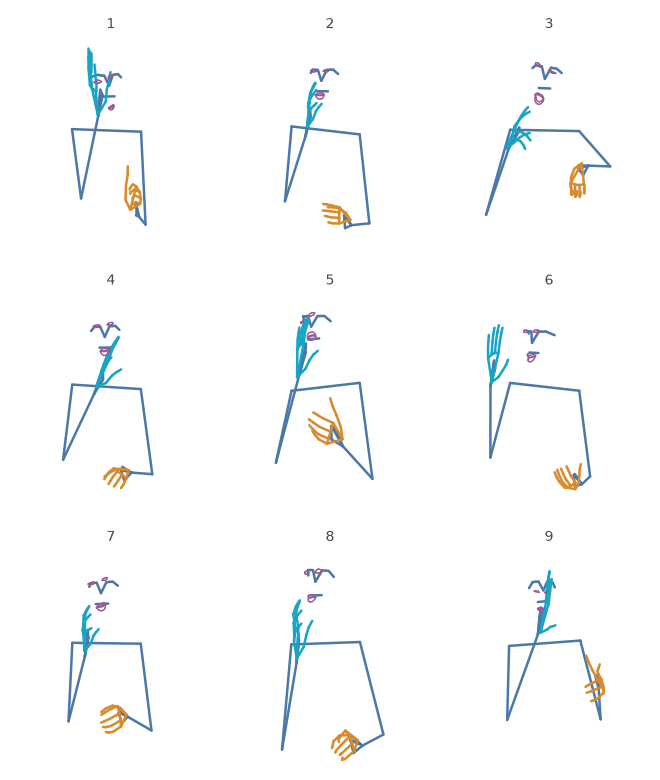
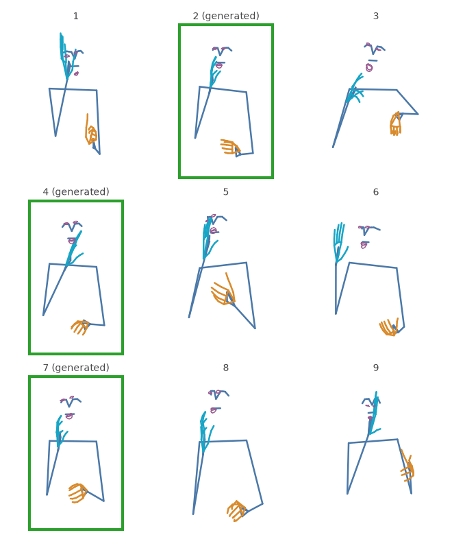

# MTGP-VAE for Sign Language Analysis

Code of *Multi-Task Gaussian Process VAE for Sign Language Analysis* (ESANN 2027).

## Model intuition and results

Check out [our companion blog post](https://simlej18.github.io/ESANN27_MTGPVAE4SL/) for many interactive illustrations!

### A VAE encodes poses, not motion

Each frame is encoded on its own. Reconstructions are faithful, but the prior knows nothing about time: sampled frames
jump from one pose to the next.



### A GP-VAE adds time, not meaning

A Gaussian process along time on each latent dimension makes samples smooth, but they drift without meaning.



### The MTGP-VAE learns the motion of each sign

Each sign gets a mean trajectory μ_s(t), shared by all its clips; a clip is this trajectory plus its own smooth
deviation e_c(t).



Decoding μ_s shows the sign the model has learned; sampling a new deviation generates new clips of the sign.



### It recognises signs...

A clip is classified by its likelihood under each sign's trajectory (100 signs, balanced accuracy %, higher is better).

| Model | Top-1 | Top-5 |
|---|---|---|
| Sign-VAE | 42.5 | 74.1 |
| Sign-GP-VAE | 41.4 | 73.1 |
| Sign-GP-VAE + MTGP post-hoc | 53.5 | 80.3 |
| **MTGP-VAE** | **56.3** | **83.1** |

### ...it spots and fixes tracking errors...

A frame unlikely under its sign's trajectory is an outlier; the body part at fault is redrawn from the other frames.
Here MediaPipe puts the right hand on the left wrist for one frame; the model's correction is in green.



### ...and it can generate new clips too!

Try to spot the **3 generated samples** among these 9 clips of *comprendre* ("to understand")!

*Answer at the end of the readme.*



### This is possible thanks to...

* The [MagmaClust framework](https://jmlr.org/papers/v24/20-1321.html) by Leroy et al.
* The [Kernax](https://github.com/UNamurCSFaculty/kernax-ml) and [Mimosa](https://github.com/UNamurCSFaculty/mimosa-ml) implementations by Lejoly et al.
* The [LSFB corpus](https://huggingface.co/datasets/ppoitier/lsfb-isol) by the [LSFB-Lab](https://www.unamur.be/fr/naltt/lsfb-lab) and [HuMaLearn Team](https://humalearn.info.unamur.be/)

## Reproducing the results

Every result comes from one `just` command (`just` lists them all). The trained models are in `checkpoints/`, so
Table 1 and the figures can be reproduced without training, on CPU.

### Install

Requires Python 3.14, [uv](https://docs.astral.sh/uv/) and [just](https://just.systems/).

```bash
just install             # CPU
just install gpu         # NVIDIA GPU (CUDA 12)
```

### Data

The experiments use LSFB100: the 100 most frequent signs of
[LSFB-ISOL](https://huggingface.co/datasets/ppoitier/lsfb-isol), clips of 8 to 48 frames.
We do not redistribute the poses: `data/lsfb100.csv` lists the clips (split, id, sign, mirror flag) and
`data/signs.txt` the sign order; a script builds the dataset from the HuggingFace release.

```bash
just pull-isol   # LSFB-ISOL poses, ~3 GB, into ~/datasets/lsfb/lsfb-isol (pinned revision)
just data        # data/lsfb100.npz (~370 MB, ~1 min)
just stats       # clips, frames and signers of LSFB100, per split
```

`pull-isol` and `data` take the dataset folder as an argument, e.g. `just pull-isol /data/lsfb-isol` then
`just data /data/lsfb-isol`.

### Table 1 (classification)

```bash
just table                                      # the four evaluations, then the table (results/*.json, ~10 min)
just evaluate checkpoints/mtgp_vae              # or one model at a time
just evaluate checkpoints/sign_gp_vae --posthoc # under a Magma prior fitted on its frozen codes
```

The post-hoc prior of the Sign-GP-VAE is provided (`checkpoints/sign_gp_vae_posthoc.eqx`); without it, `--posthoc`
fits it again (~1 h on a GPU).

### Figures

```bash
just figures   # figures 1-3 of the paper -> figures/*.svg (+ *.pdf with rsvg-convert)
```

### Training

The three models start from the pre-trained VAE (`checkpoints/vae_pretrained`), 25k steps each: Sign-VAE, Sign-GP-VAE
and MTGP-VAE (the same MTGP prior, restricted for the first two, see `mtgpvae/prior.py`). The MTGP-VAE is then
fine-tuned with a tempered classification loss.

```bash
just train-all                 # everything, one run after the other (~30 h on one GPU)
just train sign_vae            # or one model at a time: sign_vae, sign_gp_vae, mtgp_vae
just finetune                  # MTGP-VAE fine-tuning, from checkpoints/mtgp_vae_base
```

### Pre-training the VAE (optional)

The pre-trained VAE is provided (`checkpoints/vae_pretrained`). To pre-train it again, on the unannotated recordings of
[LSFB-CONT](https://huggingface.co/datasets/ppoitier/lsfb-cont) (except those LSFB100 validation clips come from):

```bash
just pull-cont      # LSFB-CONT poses, ~20 GB, into ~/datasets/lsfb/lsfb-cont (pinned revision)
just data-cont      # data/cont_frames.npy (~8 GB); needs data/lsfb100.npz (`just data`)
just pretrain-vae   # 1M steps, ~30 min on a GPU -> checkpoints/vae_pretrained
```

### Repository structure

```
mtgpvae/        the package
  pose.py         skeleton layout (137 MediaPipe landmarks, x / y), left-right mirror
  data.py         LSFB100 clips and LSFB-CONT frames, normalisation, time grid
  vae.py          frame-level body-part VAE
  prior.py        MTGP prior per latent dim; Sign-VAE and Sign-GP-VAE as special cases
  model.py        posterior and training loss (reconstruction, KL, classification, interpolation)
  inference.py    codes, sign posteriors, classification, post-hoc Magma fit, generation
scripts/        one script per command of the justfile
data/           LSFB100 clip list and sign order (the built datasets are not versioned)
checkpoints/    pre-trained VAE, the three trained models, the post-hoc prior
results/        Table 1, one json per model
figures/        figures 1-3 of the paper; gifs/: the animations of this README (illustrations, no script)
```

## License

MIT (see `LICENSE`).

---

**Quiz answer:** the generated clips are framed; the others are real LSFB-ISOL clips of *comprendre* (to understand).


